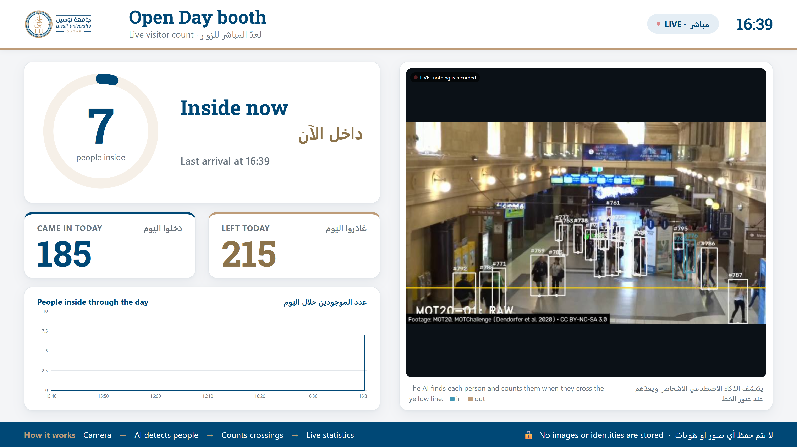
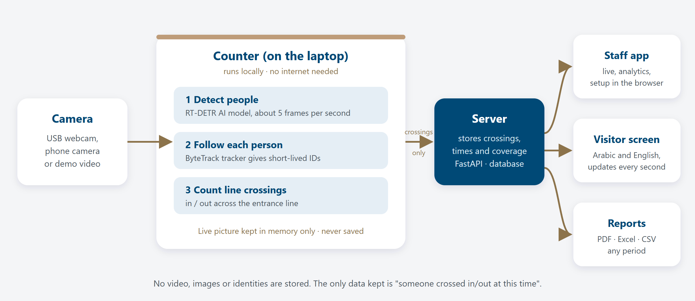
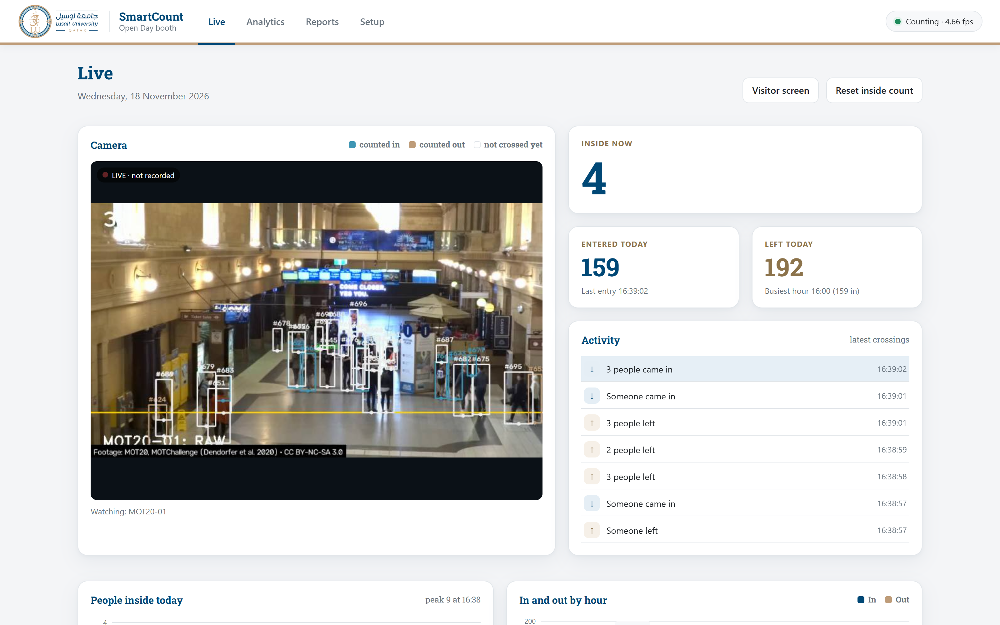
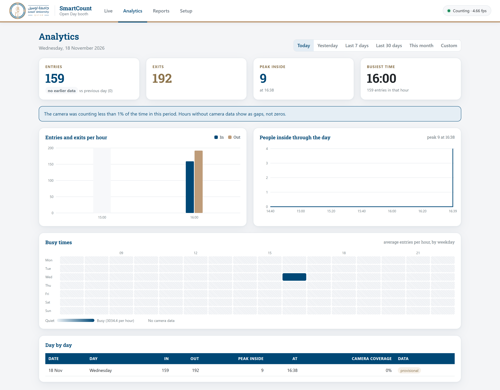
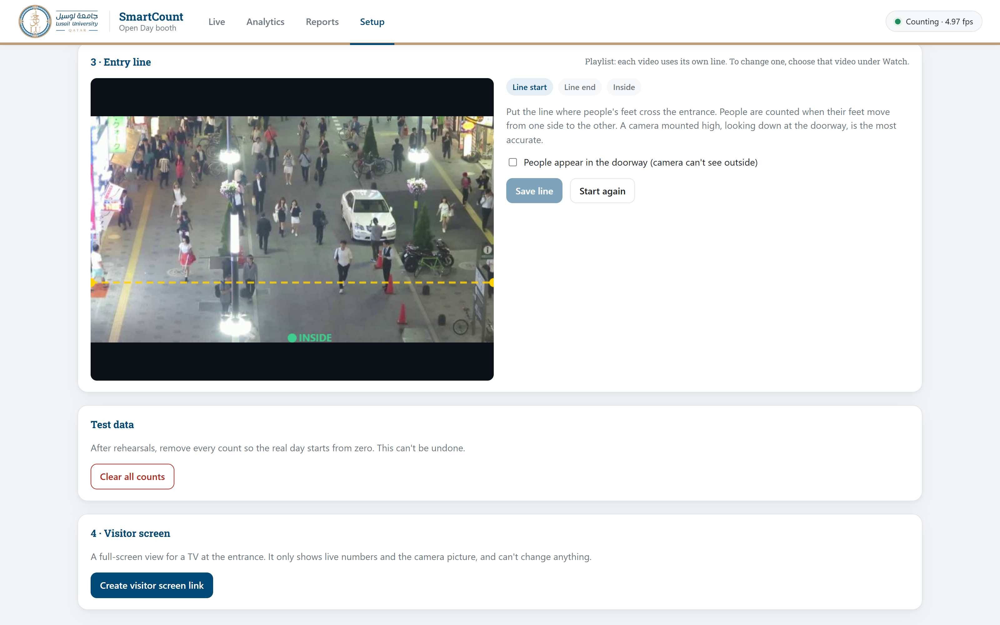
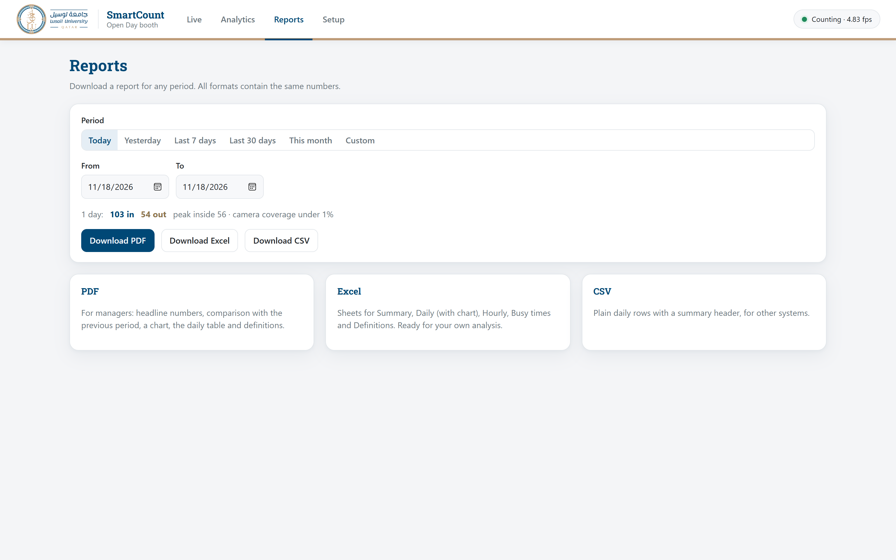
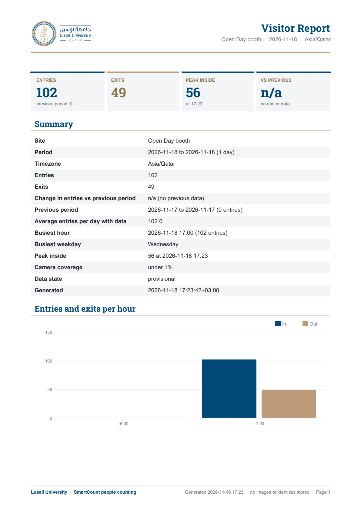

# LU SmartCount

**Privacy-first people counting for Lusail University.**
An AI system that counts people walking in and out of an entrance with an ordinary camera, shows the numbers live,
and produces reports. No video is recorded and nobody is identified.

*Independent project by **Awab Mohamed**, third-year student at Lusail University.
Shown at the Lusail University Open Day, 26 November 2026.*

---

## The problem

Counting visitors, for example at the university library, is usually done by hand. It takes staff time, mistakes are
hard to spot, and the numbers can't easily be compared across days, weeks or semesters. Commercial people counters
exist, but they need special sensors and subscriptions, and the data usually leaves the organisation.

## Objectives

- Count people **in and out** of an entrance automatically, with an ordinary webcam or phone.
- Keep it **private**: no video, photos or identities stored; everything runs on-site.
- Show the numbers **live** and turn them into **reports** a library or event team can use.
- Be **set up anywhere in minutes**, from a web browser.
- **Measure accuracy honestly**, against official hand-labelled data.

## How it works

1. **Detect people.** An AI model (RT-DETR) finds every person in each camera frame, about 5 times per second.
2. **Follow each person.** A tracker (ByteTrack) links the same person from frame to frame with a short-lived number.
3. **Count line crossings.** When a person's feet cross the entrance line drawn in Setup, it counts one **in** or **out**.
   A narrow band around the line and a short confirmation stop jitter or someone pausing on the line from being counted twice.
4. **Store only the crossing.** The counter sends the server "someone crossed in at 10:42". The live picture stays in memory
   and is never saved.
5. **Show and report.** The staff app and the visitor screen update every second; reports are generated for any period.

## What it does

| | |
|---|---|
| **Live** | Camera picture with people boxed (light blue: counted in, gold: counted out, white: not crossed yet), people inside now with a capacity warning, entries and exits today, an activity feed and today's charts |
| **Visitor screen** | Full-screen TV view in Arabic and English, read-only, for the entrance of an event or library |
| **Analytics** | Any period: change against the previous period, peak inside and when, busiest hour and weekday, hourly or daily charts, a busy-times heatmap and a day-by-day table |
| **Reports** | PDF for managers, Excel with charts, and CSV, all from the same numbers |
| **Setup** | Choose a camera (built-in webcam, USB camera, phone) or a demo video, draw the entry line on the live picture, and create the visitor screen link |
| **Honest data** | Time when the camera wasn't running shows as "no data", never as zero |

### Reports

Pick any period and download it as PDF, Excel or CSV. Every format is built from the same numbers as the app.

Example files, made by the system from a short demo run:
[PDF report](docs/examples/example-report.pdf) · [Excel workbook](docs/examples/example-report.xlsx)

## Results

Measured end to end on the live system, against the six [MOTChallenge](https://motchallenge.net) videos that have
official hand-labelled answer keys: busy stations, streets and a stadium exit, **588 real line crossings**.

| | Result |
|---|---|
| People counted, compared with the true total | **98%** (579 of 588) |
| Real crossings detected at the right moment | **85%** |
| Counts that matched a real person crossing | **87%** |
| Calm scenes (a few people at a time) | within **1–2 people** of the truth |
| Time from crossing the line to the dashboard's data | **1.1 s** typical, 9 in 10 within 1.6 s |
| Time until it appears on screen | about **1.5–2 s** |
| Speed on an ordinary laptop (Ryzen 7, built-in graphics) | about **5 frames per second** |

Tuning made a large difference: the first version counted only **57%** of the true total. Lowering the detector and
tracker thresholds and tightening the counting band, measured against the answer keys each time, raised it to 98%.

**Limits, honestly:** the hardest clips are very dense crowds (hundreds of people at night), where people hidden behind
others are missed. A real entrance with the camera mounted high and angled down is much easier. Accuracy at a real
entrance still has to be measured in a pilot with hand counts.

## Privacy by design

- No video, photos or face data are stored, on the laptop or anywhere else.
- No identities: a person is a temporary number that disappears within seconds.
- Runs entirely on-site; no internet or cloud is needed.
- The only data kept is the time and direction of each crossing.

## Built with

Python · RT-DETR (Apache-2.0) · ONNX Runtime with DirectML · ByteTrack (Roboflow `trackers`, Apache-2.0) · OpenCV ·
FastAPI · SQLAlchemy / SQLite · HTML, CSS and JavaScript (no external libraries, works offline) · ReportLab and openpyxl
for reports. Every component has a permissive licence; there are no licence fees.

## Future work

- A pilot at the Lusail University library with hand-count validation (target within 5%).
- Several entrances and cameras in one site.
- A hand-count mode in the app to measure accuracy on the spot.
- Staffing insights: busy-time forecasts from past days.

## About this repository

This is the public showcase. The production code is kept private.

The demo footage in the screenshots is from MOTChallenge (MOT17: Milan et al. 2016; MOT20: Dendorfer et al. 2020),
used under CC BY-NC-SA 3.0 for non-commercial demonstration. Screenshots that contain it are shared under the same licence.
The example reports count people in that footage; the busy streets and crowds in it are not an entrance, so entries
and exits don't balance the way they would at a real door.
The Lusail University name and logo are used with the university's permission and are not covered by any licence here.

© 2026 Awab Mohamed. All rights reserved, except as stated above for the demo footage.
